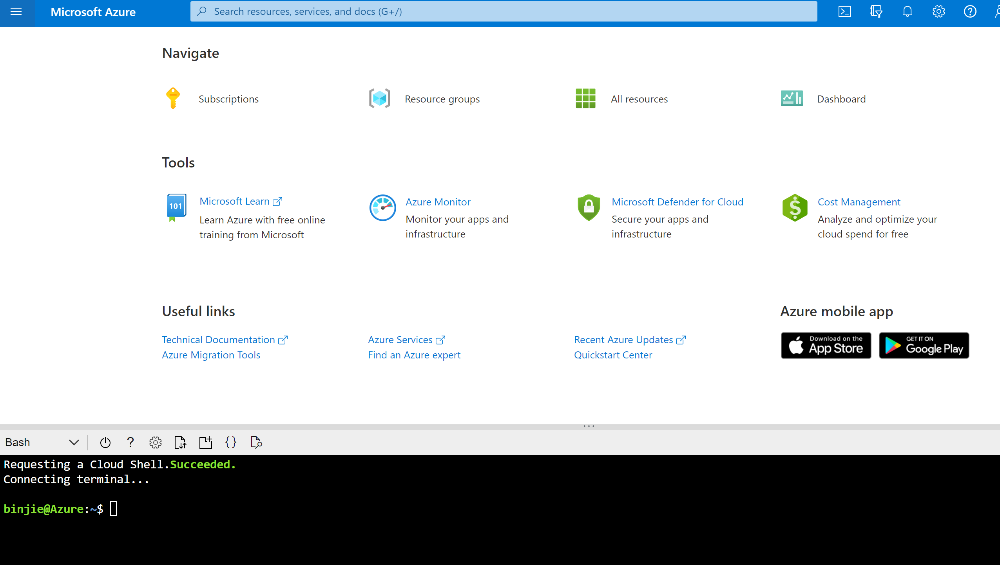
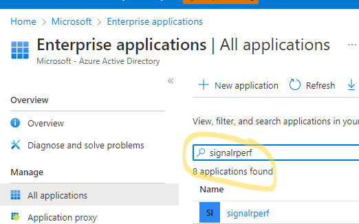
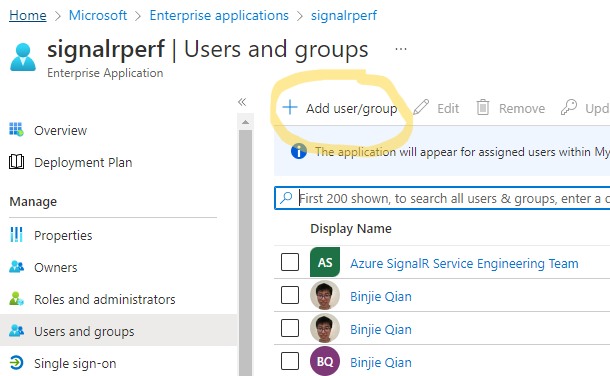

# Setup

## Dependency
1. [WSL](https://docs.microsoft.com/en-us/windows/wsl/install) or Linux 
2. [az cli](https://docs.microsoft.com/en-us/cli/azure/install-azure-cli-linux?pivots=apt) [Version >=2.72]
3. [.NET 6 sdk](https://dotnet.microsoft.com/en-us/download/dotnet/6.0)
4. A tenant you are allowed to [register AAD applications](https://docs.microsoft.com/en-us/azure/active-directory/develop/howto-create-service-principal-portal#permissions-required-for-registering-an-app) 
5. [jq](https://stedolan.github.io/jq/) , [nodejs](https://nodejs.org/en/) , [npm](https://www.npmjs.com/package/npm), [helm](https://helm.sh/docs/intro/install/#from-pkg-freebsd)

>To avoid dealing with those dependencies (except 4), you could use **Azure Cloud Shell** to run all the scripts. The dependencies have been installed in the Azure Cloud Shell env already.

In the Azure Cloud shell: Bash (**Recommended** :grinning:)
```bash
git clone --single-branch --branch v2 https://github.com/Azure/azure-signalr-bench.git
```
<kbd></kbd>

## Steps
SignalR performance tool uses AKS to run the tests. To setup the initial environment, you could run below script. :smiley: Make the [prefix] unique. [location] is the region you put your resouces in like eastus.

> :warning: **Below init script will create resources and generate cost !**
```bash
cd Initialize && chmod +x ./*.sh
./init.sh -p [prefix] -l [location]  ## This will take about 20 minutes
```
Grant permission to users/groups

1. [Assign the Contributor role to allowed users](https://docs.microsoft.com/en-us/azure/active-directory/develop/howto-add-app-roles-in-azure-ad-apps#assign-users-and-groups-to-roles)
   First find your service principle in your AAD Enterprise applications. Use your [prefix] to search the service principle
  
  <kbd> </kbd>
   
    Select the service principle and add user/group. This will determine who can access the test tool portal. 
    
    You can come back and add more people later. Add yourself now.
   
  <kbd>  </kbd>
  
2. <s>  Modify the Azure AAD config (clientID and TenantID) in src/Pods/Portal/appsettings.json accordingly(Use the clientID and tenantID of the Application you just created). </s>


After that, you need to init the deployments inside the aks

```bash
./publish.sh -p [prefix] -a #This will take about 20 minutes
```

**Now everything is ready, you could go to the printed url to create performance tests! :blush:**

### FAQs
1. Failed trying to add nodePool or setup aks. Failed to scale up VMs after starting a test. 
> VM quota issues: You need to change the VM size according to the quota in your subscription or [request VM quota](https://docs.microsoft.com/en-us/azure/azure-portal/supportability/per-vm-quota-requests). The current used VM SKU is **Standard_D4s_v3**. You could also use other VM types. But make sure the VM type has at least **4 cores**. The node pool could be added in the **AKS node pool configration**.
> 
><kbd></kbd>

> Outbound IP port issue: You need to [add more ips](https://docs.microsoft.com/en-us/azure/aks/load-balancer-standard#scale-the-number-of-managed-outbound-public-ips) to your load balancer if you trying to add a large node pool 

2. SSL cert not safe
> NSG issue: If the NSG in the created AKS resource group blocks inbound traffic, the SSL certificate verification would fail. 

3. What's the portal domain? Run below command to get the urls
>  ./publish -p [prefix] 

## Use the perf tool from an AI agent (MCP)

The portal exposes an [MCP](https://modelcontextprotocol.io) endpoint so agents such
as GitHub Copilot can manage test configs, start or cancel tests, and read results.
The agent signs in with your Microsoft Entra account: `Reader` can read data;
`Contributor` can also change configs and runs. Service access keys are masked.

1. Configure the portal's app registration and deploy the MCP-enabled portal:
   ```bash
   cd Initialize
   bash ./enable_mcp.sh -p [prefix] --resource-url https://[portal domain]/mcp
   ./publish_docker.sh -p [prefix] -ar [aks region] --portal
   ```
   Use the portal's external domain, verified in its Entra tenant. The URL must
   match `resource` in `https://[portal domain]/.well-known/oauth-protected-resource/mcp`.
   The script enables v2 access tokens for the portal app; check any other API
   consumers before changing an existing registration. Skip publishing if the
   MCP endpoint is already deployed.
2. Add the server to VS Code's workspace or user `mcp.json`:
   ```json
   {
     "servers": {
       "perf": { "type": "http", "url": "https://[portal domain]/mcp" }
     }
   }
   ```
   Start `perf` and complete sign-in when prompted. VS Code discovers the tools
   your role can use; no static bearer token is needed.

### Run a pipeline-style batch

Use `start_test_batch` to submit existing test directories with the same admission
limits as the pipeline. This submits tests, not the pipeline's approval and
dependency stages. Preview the batch first:

```json
{
  "directories": ["directory-a", "directory-b"],
  "index": "repro-1",
  "unitLimit": 300,
  "instanceLimit": 1,
  "dryRun": true
}
```

Check the planned tests and host locations, then set `dryRun` to `false` to submit.
Use a **new index for each attempt**: lowercase letters, digits and single hyphens,
with test name plus `--` plus index no longer than 63 characters. A failed
submission may have queued some tests, so inspect that index before retrying.

Monitor with `list_test_runs` using the exact `index`, then `get_test_run` for
reports. If authentication expires, reconnect `perf` and sign in again; tests
continue independently, so resume monitoring rather than submitting them again.

## Test results and upgrades

A cleaned-up test is not necessarily a passed test. Check its result and report:
command errors or participant replacement fail the run, and cancellation remains
cancelled after cleanup. Directory checks pass only when all submitted finite
runs and their configured round reports are complete. Historical runs without
the new batch metadata remain viewable but cannot pass this check.

Stopping a scenario cancels sends and waits for them to finish before the next
round. Legacy ASP.NET SignalR 2.x cannot cancel an active send, so its stop may
still wait for that send to finish.

Older participant images do not support the coordinator's new readiness checks.
When upgrading an existing deployment:

1. Finish active tests and pause new submissions.
2. Publish **Client, AppServer, SignalRUpstream, WpsUpstream, SioServer and
   WpsPyServer** first. Update legacy ASP.NET/Windows or source packages too if used.
3. Deploy **Coordinator**, then **Portal**, and verify a small test with a fresh index.

`publish_docker.sh` builds images in ACR, so local Docker is not required.
Its `--coordinator` and `--portal` options also replace running deployments;
do not use them during an active test.

For local Socket.IO builds, use Node.js 22 and the committed lockfile:
```bash
cd src/Pods/SioServer
npm ci --include=dev --engine-strict
npm run build
```

# Contributing

This project welcomes contributions and suggestions.  Most contributions require you to agree to a
Contributor License Agreement (CLA) declaring that you have the right to, and actually do, grant us
the rights to use your contribution. For details, visit https://cla.microsoft.com.

When you submit a pull request, a CLA-bot will automatically determine whether you need to provide
a CLA and decorate the PR appropriately (e.g., label, comment). Simply follow the instructions
provided by the bot. You will only need to do this once across all repos using our CLA.

This project has adopted the [Microsoft Open Source Code of Conduct](https://opensource.microsoft.com/codeofconduct/).
For more information see the [Code of Conduct FAQ](https://opensource.microsoft.com/codeofconduct/faq/) or
contact [opencode@microsoft.com](mailto:opencode@microsoft.com) with any additional questions or comments.
